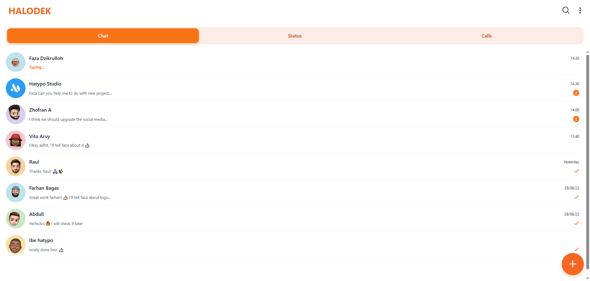

# HALODEK — React Native UI Challenge

A chat interface built with Expo, React Native, TypeScript, and NativeWind. This project recreates a supplied design reference using reusable components and local sample data.

## Screenshot 

  

## Download Android APK

[Download HALODEK APK from Google Drive](https://drive.google.com/drive/folders/1PyOsSDSe7o9vQX71Hh_g7LZdbWELUQ-K?usp=drive_link)

Open the folder, download the APK, and install it on your Android device.

## Features

- Custom header with search and menu icons
- Search chats by name
- Chat, Status, and Calls tab selection
- Chat list with avatar images and pastel backgrounds
- Message previews and typing indicators
- Unread message badges and read indicators
- Floating new-chat button

Search filters chats by name. The menu switches between all and unread chats, avatars open larger previews, and the plus button opens a contact picker. Tabs update their selected appearance.

## Tech Stack

- Expo
- React Native
- Expo Router
- TypeScript
- NativeWind
- Expo Vector Icons

## Getting Started

### Prerequisites

- Node.js and npm
- Expo Go on a mobile device, or an Android emulator

### Installation

Clone the repository, open its folder, and install dependencies:

    npm install

Start the development server:

    npx expo start

Scan the QR code with Expo Go, press `a` for an Android emulator, or press `w` to open the web version.

To restart with a cleared Metro cache:

    npx expo start --clear

## Project Structure

    assets/
      images/                 # Avatars and app assets
    src/
      app/
        _layout.tsx           # Root navigation and global CSS import
        index.tsx             # Chat screen, sample data, and search
      components/
        ChatHeader.tsx        # Title and search input
        ChatTab.tsx           # Chat, Status, and Calls selector
        ChatListItem.tsx      # Individual chat row
        NewChatButton.tsx     # Floating action button
      global.css              # Tailwind directives

## Design Reference

The interface is based on a screenshot supplied for the challenge. Original image assets were not provided, so substitute avatars are used.

## Project Scope

This is a frontend UI challenge. Chat data is stored locally, and no backend, authentication, or real-time messaging is connected.

## Learning Focus

- Building layouts with React Native
- Styling with NativeWind
- Creating reusable components
- Passing data through props
- Managing state with React hooks
- Rendering lists with FlatList
- Filtering data with a search input

